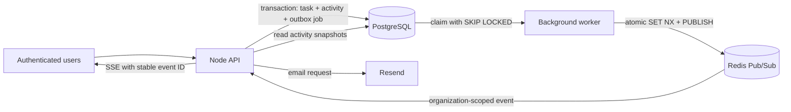

# Assessment 15 - Architecture and Incident Response

## Status and scope

Task updates now use optimistic concurrency, append before/after task snapshots, and enqueue version-keyed events in the same PostgreSQL transaction. The existing PostgreSQL job queue and Redis Pub/Sub channel are reused.

The fault-injection tests below were run against local PostgreSQL with Redis and Resend behavior mocked. They are not evidence of a production incident or a manual outage drill. No production service was contacted or disrupted.

## Architecture



PostgreSQL remains the source of truth for tasks, activity snapshots, and pending jobs. Redis Pub/Sub is a transient notification path; clients can fetch the durable activity history if they reconnect or miss a stream event.

## Task update and event data flow

```mermaid
sequenceDiagram
    participant A as User A
    participant B as User B
    participant API as Node API
    participant PG as PostgreSQL
    participant W as Worker
    participant R as Redis
    A->>API: PATCH status, expectedVersion=N
    B->>API: PATCH status, expectedVersion=N
    API->>PG: BEGIN; SELECT task FOR UPDATE
    PG-->>API: Current version N
    API->>PG: Update to N+1; insert snapshot and unique outbox job
    API->>PG: COMMIT
    API-->>A: 200 with task version N+1
    API-->>B: 409 with current task/version
    W->>PG: Claim outbox job
    W->>R: Publish stable background-job event ID
    R-->>API: Organization task event
    API-->>A: SSE event with id
```

`PATCH /api/tasks/:id` (also `/api/v1/tasks/:id`) requires `expectedVersion`. A missing value returns `428`; an invalid value returns `400`; a stale value returns `409` and includes the current task and version. The successful update, version increment, activity snapshot, and version-keyed outbox insert commit together. `GET /api/tasks/:id/activities` provides organization-scoped history and is also available under `/api/v1`.

Each activity stores the actor, task version, timestamp, and complete task snapshots before and after the change. New tasks receive a creation snapshot. The migration captures a `baseline_snapshot` for existing tasks; historical edits that predate the migration cannot be reconstructed.

## Idempotency and recovery behavior

- The outbox key for a task update is `task.updated:<task-id>:<version>`. Repeating an enqueue for that version cannot create a second job.
- The worker uses the durable job ID as the event ID. Redis atomically checks the deduplication key, publishes, and sets a seven-day marker only when at least one Redis subscriber is present. A retry with an existing marker is suppressed while Redis retains it.
- Redis failures propagate to the existing worker retry/backoff path. The queued job remains in PostgreSQL.
- SSE includes the event ID in its `id:` field. On reconnect with `Last-Event-ID`, the API can replay task-event rows from PostgreSQL, including queued jobs that have not yet been published.
- Pub/Sub still has no consumer acknowledgement. The SSE replay is a recovery path, not a notification platform or an exactly-once guarantee; clients must deduplicate repeated event IDs. Redis loss can also clear its seven-day dedupe markers.

## Local setup

Use an isolated local/test PostgreSQL database and synthetic accounts only. Do not point these commands at production.

1. Install the existing Node dependencies with `npm ci`.
2. On a new local Compose database, the scripts in `docker/postgres/init` are applied by the init-directory mount. For a new standalone local/test database, `node create-db.cjs` initializes the core schemas through Assessment 15. For an existing local/test database, set `DATABASE_URL` to that isolated database, configure a URL-safe `WORKSPHERE_APP_PASSWORD`, then run the versioned migrations:

   ```powershell
   node server/migrate.cjs
   ```

3. Configure the local test `JWT_SECRET` as the application setup requires. Run the tests from the repository root:

   ```powershell
   npm test -- --runInBand
   ```

The versioned migrations add `tasks.version`, create `task_activities`, backfill one baseline snapshot per existing task, add the app role, and add query-pattern indexes. The activity-history migration is transactional and idempotent. Never point the local migration command at a production or remote database as part of this assessment.

## Injected incident scenarios and root-cause analysis

These are synthetic fault-injection analyses based on the automated tests, not reports of production incidents.

| Scenario | Injected cause and observed result | Recovery / evidence |
|---|---|---|
| Database latency | A local worker query is delayed and then fails as a timeout. The worker logs the failure; the queued job remains pending. | The next poll resumes and completes the job. Covered by the delayed-query tests in `server/tests/backgroundJobs.test.ts` and `server/tests/workerResilience.test.ts`. |
| Redis outage | Redis event publishing rejects. The worker records the error and reschedules the job instead of marking it complete. | Restore Redis, then allow the existing worker retry to publish. The local test mocks the outage; it does not stop a Redis service. Covered by `server/tests/taskEvents.test.ts` and `server/tests/backgroundJobs.test.ts`. |
| Duplicate job / retry after publish | A duplicate enqueue uses the same key, or an already-published job is delivered again after simulated requeue. | PostgreSQL retains one outbox job per key; the worker reuses the event ID and Redis's atomic marker suppresses repeat publication. Covered by `server/tests/backgroundJobs.test.ts` and `server/tests/taskEvents.test.ts`. |
| External email failure | The Resend call is mocked to reject. The API returns a generic `500` without provider details in the response. | After provider recovery, an operator/client can retry the request. This email endpoint is synchronous and has no automatic email retry queue. Covered by `server/tests/assessment08.test.ts`; no external email was sent. |
| Stale task update | Two users in the same test organization submit updates against the same version. One commits; the other receives `409`. | Refresh the task and submit against the returned version. Only the successful change is recorded and queued. Covered by `server/tests/task.test.ts`. |
| Cross-tenant access | A user from another test organization requests task history or updates the task. | Both return `404` without disclosing task existence or history. Covered by `server/tests/task.test.ts`. |

## Incident drill execution record - 2026-11-26

All six scenarios were executed as automated local/test simulations; no manual service interruption was performed. Before running database-backed tests, a read-only query confirmed the target was local:

```sql
SELECT current_database() AS database,
       inet_server_addr()::text AS server_address;
```

Observed result: `worksphere_db`, `127.0.0.1/32`. The test process received a local `DATABASE_URL`; credentials are not recorded here.

Exact focused command:

```powershell
npm test -- --runInBand --verbose server/tests/task.test.ts server/tests/taskEvents.test.ts server/tests/workerResilience.test.ts server/tests/backgroundJobs.test.ts server/tests/assessment08.test.ts
```

Captured Jest summary:

```text
Test Suites: 5 passed, 5 total
Tests:       18 passed, 18 total
Snapshots:   0 total
```

| Drill | Automated result and relevant log/assertion | Evidence |
|---|---|---|
| Database latency | A real local PostgreSQL-backed pending job was left unchanged when a delayed query threw `Simulated database latency timeout`; the next worker poll completed it. A mock-based poller test also asserted the `Background worker error:` log and successful next poll. | `keeps a job pending through database latency and resumes polling`; `survives a delayed database timeout and resumes polling` in [background job tests](../server/tests/backgroundJobs.test.ts) and [worker resilience tests](../server/tests/workerResilience.test.ts). |
| Redis outage and recovery | The simulated publisher failure recorded `last_error = Simulated Redis outage`, `status = pending`, and one attempt. After advancing the retry time, processing completed the job. The Redis client test also verified an injected Redis error propagates to the worker retry path. | `reschedules a job during a simulated Redis outage`; `propagates Redis outages so the job worker can retry` in [background job tests](../server/tests/backgroundJobs.test.ts) and [task event tests](../server/tests/taskEvents.test.ts). Redis itself was not stopped. |
| Duplicate job delivery | Two enqueues with the same idempotency key left one row. Reprocessing that row reused its event ID; the mocked Redis client received the same dedupe key twice and recorded one marker while the test verified the Lua script uses `NX` and `PUBLISH`. | `reuses the same event ID when a published job is delivered again`; `uses one atomic Redis marker for repeated delivery of the same event` in [background job tests](../server/tests/backgroundJobs.test.ts) and [task event tests](../server/tests/taskEvents.test.ts). |
| Email provider failure and recovery | The mocked provider first rejected delivery; the API returned `500` with `Internal server error` and no provider detail. Retrying after the mock recovered returned `200`. No external email request or recipient was used. | `POST /api/integrations/email - should return a safe error when delivery fails` in [Assessment 08 integration tests](../server/tests/assessment08.test.ts). |
| Two-user stale task update | Two authenticated users in the same organization submitted version `1` concurrently. One returned `200` with version `2`; the other returned `409` with current version `2`. History contained versions `1` and `2`, and one update job existed. | `allows only one concurrent update from the same task version` in [task tests](../server/tests/task.test.ts). |
| Cross-tenant task access | A user from another organization received `404` for both task update and activity-history requests. | `hides task and activity history from another organization` in [task tests](../server/tests/task.test.ts). |

These are automated simulations, not evidence of production incidents. The assertion-level logs and outcomes are captured above; no separate raw terminal transcript was saved.

## Validation evidence

| Command | Result |
|---|---|
| `npm test -- --runInBand --verbose server/tests/task.test.ts server/tests/taskEvents.test.ts server/tests/workerResilience.test.ts server/tests/backgroundJobs.test.ts server/tests/assessment08.test.ts` | Passed: 5 suites, 18 tests |
| `npm test -- --runInBand --verbose server/tests/task.test.ts` (fresh local `worksphere_test`) | Passed: 1 suite, 4 tests |
| `npm test -- --runInBand` (with `DATABASE_URL` targeting verified local `worksphere_db` at `127.0.0.1/32`) | Passed: 11 suites, 50 tests |
| `npx tsc -p tsconfig.server.json --noEmit` | Passed |
| `npm run lint` | Passed |
| OpenAPI JSON parse check | Passed |
| `git diff --check` | Passed |

### Follow-up: isolated local verification after missing-table failure

A separately supplied Jest run used the remote Neon database named `neondb` (its environment was not known) and reported 10 suites passing and 1 failing. All four failures in `server/tests/task.test.ts` were caused by PostgreSQL reporting `relation "task_activities" does not exist`. Neon was not contacted, inspected, or migrated; its migration status remains unknown.

To verify the failing tests safely, a fresh PostgreSQL container was created with a unique name, bound only to `127.0.0.1:55432`, and initialized from the existing `docker/postgres/init` scripts. The isolated database `worksphere_test` contained `task_activities`. The focused command `npm test -- --runInBand --verbose server/tests/task.test.ts` passed (1 suite, 4 tests). The container was stopped and retained; the existing Compose database and its volume were not used or changed. `DATABASE_URL` and `JWT_SECRET` were set only in the test process and were not written to project configuration.

Task concurrency, activity history, job state, and tenant isolation use real transactions against local PostgreSQL. Database latency is injected in a local test; Redis and Resend failure behavior use test doubles.

## Evidence still to capture

- Screenshots or a short recording of the two-user stale-update response and resulting activity history for the submission.
- If a manual Redis drill is required, run it against a dedicated isolated Redis instance and capture the outage/recovery logs and final job status. The existing Redis service was not interrupted.
- If a real provider drill is required, use a Resend sandbox/test setup with controlled recipients only. This execution used a mock and contacted no email provider.

No live incident, manual service outage, production drill, deployment, commit, or push is claimed.

## Follow-up verification - 2026-11-26

The latest verification used a new PostgreSQL 16 container bound to
`127.0.0.1:55432`, with an in-memory container data directory. It did not use
the running Compose database, any hosted database, or an external service.

| Check | Result |
|---|---|
| `npm test -- --runInBand` | Passed: 16 suites, 74 tests |
| Focused frontend auth, registration, and workspace protection tests | Passed: 4 suites, 12 tests |
| Analytics `unittest` discovery | Passed: 14 tests |
| Processor `unittest` discovery | Passed: 9 tests |
| `npx tsc --noEmit` | Passed |
| `npm run build` | Passed |
| Targeted ESLint on changed Section 7/8 files | Passed |
| Full `npm run lint` | Failed on 3 `no-require-imports` errors in the pre-existing untracked `server/tmp-test-backup-restore.js`; that file was preserved, not modified, or executed |
| `docker compose config --quiet` | Passed; configuration only, no services started |
| Versioned migrations on a simulated prior schema | Passed: 3 applied, then 3 skipped on rerun |
| Task/project history retention after migration | Passed: 2 preexisting synthetic records survived task and project deletion with organization IDs retained; the other-tenant query returned 0 |
| PostgreSQL init role script | Passed against a fresh database in the disposable container |
| Local helper backup and restore | Passed against the disposable database; activity/job/organization counts matched (`2:0:2`) |
| `git diff --check` | Passed |

The test container and its temporary backup were removed after verification.
These results establish local implementation and automated-test behavior only;
they do not establish production delivery, exactly-once events, or a manual
Redis outage drill. The manual screenshots/recording listed above remain
submission evidence to capture.

## Follow-up verification: task UI and analytics - 2026-11-26

The authenticated owner/project-manager workspaces include a limited task
concurrency and activity-history demonstration. `e2e/task-demo.spec.ts`
exercises the two-tab stale-version UI using a mocked API; it is not evidence
of a live API transaction. The database-backed task tests remain the evidence
for server-side concurrency, history, rollback, and tenant isolation. The UI
does not implement a general task editor or consume task-event SSE.

Analytics report data is filtered by the integer organization claim in the
verified JWT. Bundled records are synthetic and scoped to organization `7`;
records without a matching organization are excluded. API tests cover a token
for another organization receiving empty productivity and overdue reports.

An in-memory synthetic benchmark compared a 100,000-task full JSON load with
streaming overdue pagination. Both paths returned identical page contents and
the same 34,286 overdue tasks. In this single run the full-load baseline took
0.719 seconds and peaked at 48.48 MiB of Python `tracemalloc` allocations; the
streaming page took 0.772 seconds and peaked at 0.50 MiB. This indicates
substantially lower Python allocation peak with a small observed runtime
increase for this workload; it is not a general production performance claim.
`tracemalloc` does not measure total process RSS.

The browser regression tests verify the landing-page login/register links,
the task conflict/reload/history UI, keyboard activation, and a 375-pixel
viewport. Their task APIs are mocked. The local frontend image was rebuilt
and verified at `http://localhost:3000`; the API/database services were left
untouched. The checked-in Compose file maps ports to loopback and contains no
TLS-terminating proxy or certificate configuration; HTTPS was not tested
against a deployed environment.
